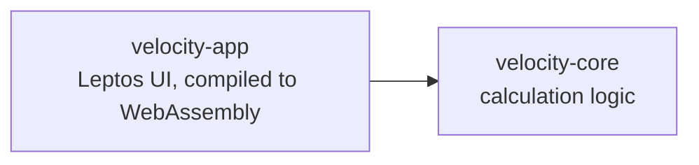

# Architecture

How Velocity Calculator is put together, and the rules every change follows.
The planner and architect agents check plans and pull requests against this file,
so if a rule here is wrong, change this file first, through a pull request.

## Overview

The app is a Rust workspace with two crates. All calculation logic lives in
`velocity-core`; everything the user sees lives in `velocity-app`, which is compiled
to WebAssembly with Trunk and runs entirely in the browser. There is no server.

Dependencies only point this way. `velocity-core` must never depend on
`velocity-app`, Leptos, or anything browser-specific.

## Crates

### `crates/velocity-core`

Pure Rust: the data types and calculations for sprint velocity.

- No UI, browser or WebAssembly dependencies, so it builds and tests natively with
  `cargo test`.
- Functions take inputs and return results. No global state, no I/O.
- Public functions and types have a doc comment.
- Every public function has unit tests in the same file, covering normal cases and
  edge cases such as empty input or zero.

### `crates/velocity-app`

The Leptos user interface, using client-side rendering.

- Calls into `velocity-core` for every calculation. No maths in UI code beyond
  formatting for display.
- Built from small components, one per file, in `src/components/`.
- The Windows 98 look comes from the project's own component library in
  `src/components/win98/` (window, title bar, button, text input and so on). Screens
  are built from these components, not from ad-hoc styled markup.
- State uses Leptos signals, held as close to where it's used as possible.

## Styling

- Colours, borders, spacing and fonts are CSS custom properties (design tokens)
  defined once in `:root`. Components use the tokens, never hard-coded values.
- No third-party theme CSS. The Windows 98 style is written from scratch.
- No code or styles copied from the original React version.

## Accessibility

The look is retro; the behaviour is modern.

- Semantic HTML: real `<button>`, `<label>` and `<input>` elements, and headings in order.
- Everything works with the keyboard, with a visible focus indicator.
- Text meets WCAG AA contrast.
- Inputs have labels, and errors are announced, not shown by colour alone.

## Errors

- `velocity-core` returns `Result` or `Option` for anything that can fail, with
  error types specific to the problem. It never panics on bad input.
- `velocity-app` turns errors into plain-English messages for the user.
- No `unwrap()` or `expect()` outside tests. This is enforced by clippy.

## Testing

| Layer | Tool | Lives in |
| --- | --- | --- |
| Calculation logic | `cargo test` | `crates/velocity-core` |
| User journeys | Playwright end-to-end | `e2e/` |

Every change comes with the tests that prove it. A bug fix starts with a test that
fails without the fix.

## Dependencies

- Prefer the standard library. Add a crate only when it clearly earns its place,
  and say why in the pull request.
- Every dependency must pass `cargo deny`: no known vulnerabilities, approved
  licences only, crates.io only.

## Hard rules

These are enforced by tooling or review, and are never broken:

- No `unsafe` code (`forbid` in the workspace lints).
- `velocity-core` never depends on UI or browser code.
- No `unwrap()` or `expect()` outside tests.
- Agents never change anything under `.github/`.

## Decisions

Significant decisions are recorded as short notes in `docs/adr/`, numbered in order
(`0001-...md`), each saying what was decided and why. When a decision changes this
file, link the decision record here.
