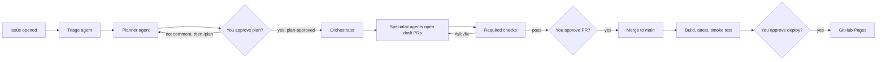
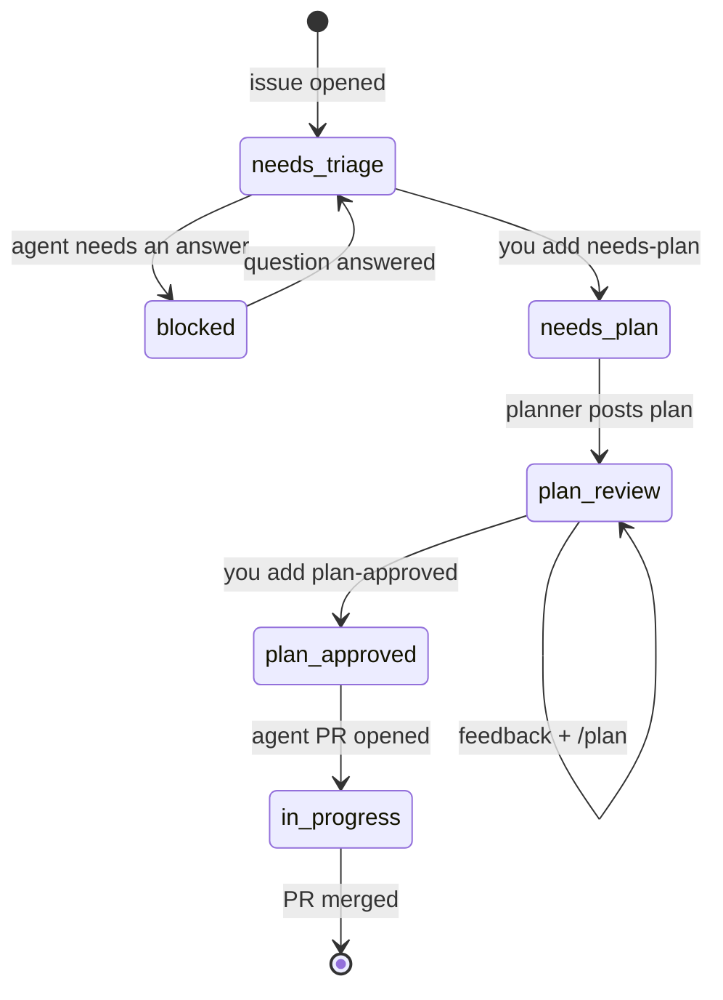
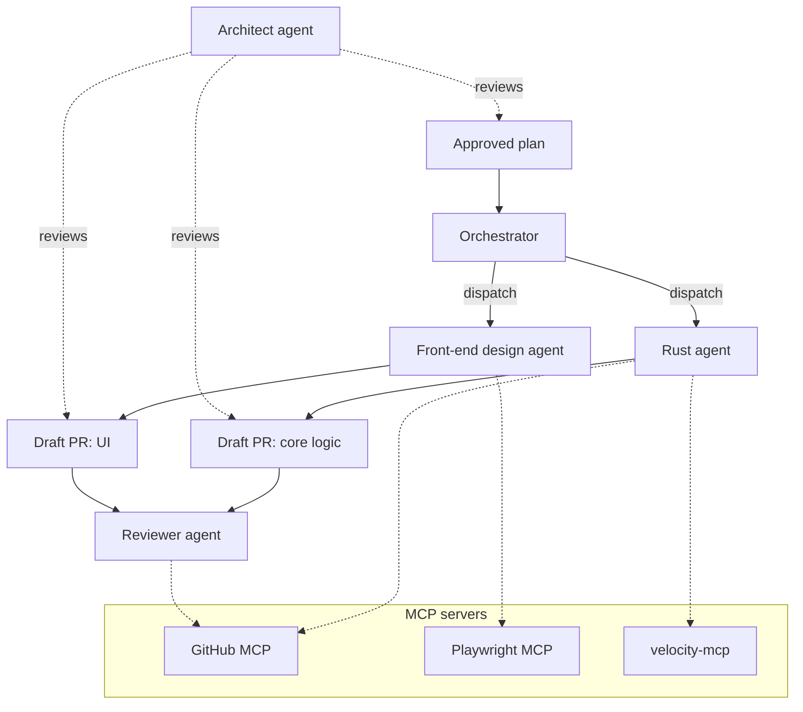
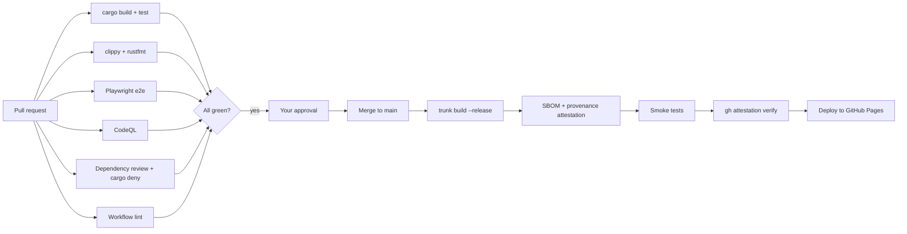

# Velocity Calculator (Rust)

A Rust rebuild of [Velocity Calculator](https://github.com/andyhutch77/velocity-calculator), compiled to WebAssembly and running entirely in the browser, hosted on GitHub Pages.

Velocity Calculator works out a team's velocity for an upcoming sprint, so it can plan how much work to commit to. The [original version](https://andyhutch77.github.io/velocity-calculator/) is a React app with a retro Windows 98 look. This rebuild matches its behaviour and look, but **no code is carried over**. The UI is written from scratch with a modern Rust front-end framework, and the Windows 98 styling comes from the project's own reusable component library and design tokens.

## Project goal

This repo has two goals:

1. **Rebuild Velocity Calculator in Rust**, as a browser-only WebAssembly app with feature parity with the original, written from scratch.
2. **Build it entirely through GitHub Agentic Workflows.** Every change starts as an issue, an agent plans it, a human approves the plan, agents implement it, and nothing ships without passing CI, security gates and human review.

It's also hands-on practice for the **GitHub GH-600: Agentic AI Developer** exam, so the setup deliberately covers each exam domain: planning before execution, tool and MCP scoping, memory and state, evaluation, multi-agent orchestration, and guardrails.

## Tech stack

| Area | Choice |
| --- | --- |
| Language | Rust, compiled to `wasm32-unknown-unknown` |
| UI framework | Leptos (client-side rendering, fine-grained reactivity) |
| Build | Trunk |
| Hosting | GitHub Pages |
| Styling | Own Windows 98 component library (window, title bar, buttons, inputs) built on CSS custom properties as design tokens; no third-party theme CSS |
| Accessibility | Semantic HTML, keyboard navigation and WCAG AA contrast, despite the retro look |
| Tests | `cargo test`, Playwright end-to-end |
| Agents | GitHub Agentic Workflows (gh-aw) with the GitHub Copilot engine |
| Security | CodeQL, secret scanning with push protection, dependency review, `cargo deny`, artifact attestations |

---

## How the agentic workflow works

### The big picture

There are three human gates: approving the plan, approving the PR, and approving the production deploy. Agents never write to the repo directly. They request actions through **safe outputs**, which run as separate, tightly scoped jobs.

### Issue lifecycle (labels)

Labels hold each issue's state. Only a human can apply `needs-plan` and `plan-approved`, the two labels that move work forward.

| Label | Meaning | Set by |
| --- | --- | --- |
| `needs-triage` | New issue, not yet looked at | Triage agent |
| `needs-plan` | Ready for an agent plan | You |
| `plan-review` | Plan posted, waiting on you | Planner agent |
| `plan-approved` | Go ahead and build it | You |
| `in-progress` | Agent PR open | Implementer agent |
| `blocked` | Agent needs an answer | Any agent |

The planner runs only when a maintainer adds the `needs-plan` label. To request a
revised plan, leave feedback in a comment, then remove and re-add `needs-plan`;
commenting by itself does not trigger the planner. The planner removes
`needs-plan` after posting a plan, so each run requires adding it again.

### Agents and orchestration

When a plan is approved, the orchestrator splits it into tasks and hands each one to a specialist agent on its own branch, so their changes don't collide. The architect agent reviews plans and PRs against `ARCHITECTURE.md` but never writes code.

| Agent | Files | Job |
| --- | --- | --- |
| Triage | `.github/workflows/triage.md` | Checks new issues are clear, asks questions |
| Planner | `.github/workflows/plan.md` | Writes a plan with approach, files, tests, risks and success criteria |
| Orchestrator | `.github/workflows/orchestrate.md` | Splits the approved plan and dispatches specialists |
| Rust agent | `.github/agents/rust.agent.md` + `impl-rust.md` | Core logic: idiomatic Rust, clippy clean, tested |
| Front-end design agent | `.github/agents/frontend.agent.md` + `impl-frontend.md` | UI, accessibility, responsive layout |
| Reviewer | `.github/workflows/pr-review.md` | Reviews each PR against its plan |
| Fixer | `.github/workflows/pr-fix.md` | Responds to `/fix` on a PR |
| Architect | `.github/agents/architect.agent.md` + `arch-review.md` | Guards structure and patterns; weekly drift report |

### CI/CD and security gates

Agent PRs face exactly the same required checks as human ones.

## Guardrails

| Agent action | Risk | Autonomy |
| --- | --- | --- |
| Label or comment on an issue | Low | Acts alone |
| Write or rewrite a plan | Low | Acts alone; you approve before any code |
| Open a draft PR | Medium | Acts alone; merge needs you |
| Merge to `main` | High | Humans only |
| Deploy to Pages | High | Human approves the environment |
| Edit anything under `.github/` | High | Blocked for agents |

- Agents run with **read-only** permissions; all writes go through capped, allow-listed safe outputs.
- `main` is protected by a ruleset: PR required, checks required, one approval, no force pushes.
- `CODEOWNERS` requires human review for anything under `.github/`.
- Safe outputs pass through **agentic threat detection** before they're applied.

## Contributing

Every change starts as an issue. Open one describing what you want, and the triage agent will pick it up. Changes to workflows, agents and repo settings are made by humans only.
