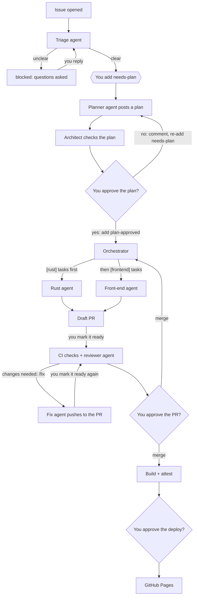
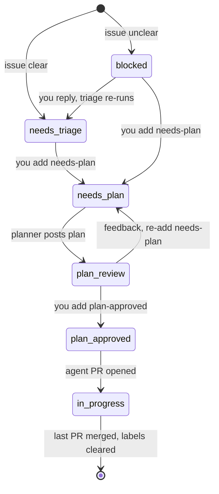
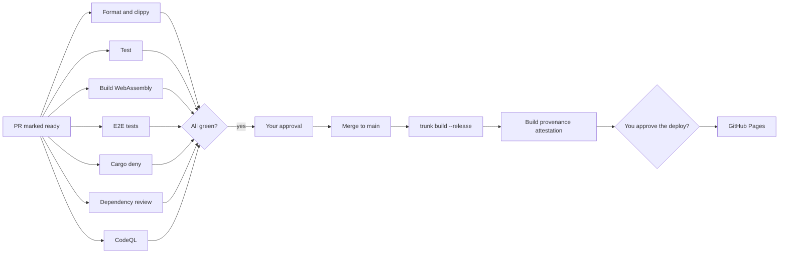

# Velocity Calculator (Rust)

A Rust rebuild of [Velocity Calculator](https://github.com/andyhutch77/velocity-calculator), compiled to WebAssembly and running entirely in the browser, hosted on GitHub Pages.

Velocity Calculator works out a team's velocity for an upcoming sprint, so it can plan how much work to commit to. The [original version](https://andyhutch77.github.io/velocity-calculator/) is a React app with a retro Windows 98 look. This rebuild matches its behaviour and look, but **no code is carried over**. The UI is written from scratch with a modern Rust front-end framework, and the Windows 98 styling comes from the project's own reusable component library and design tokens.

## Project goal

This repo has two goals:

1. **Rebuild Velocity Calculator in Rust**, as a browser-only WebAssembly app with feature parity with the original, written from scratch.
2. **Build it entirely through GitHub Agentic Workflows.** Every change starts as an issue, an agent plans it, a human approves the plan, agents implement it, and nothing ships without passing CI, security gates and human review.

It's also hands-on practice for the **GitHub GH-600: Agentic AI Developer** exam, so the setup deliberately covers each exam domain: planning before execution, tool and MCP scoping, memory and state, evaluation, multi-agent orchestration, and guardrails.

## Tech stack

| Area | Choice |
| --- | --- |
| Language | Rust, compiled to `wasm32-unknown-unknown` |
| UI framework | Leptos (client-side rendering, fine-grained reactivity) |
| Build | Trunk |
| Hosting | GitHub Pages |
| Styling | Own Windows 98 component library (window, title bar, buttons, inputs) built on CSS custom properties as design tokens; no third-party theme CSS |
| Accessibility | Semantic HTML, keyboard navigation and WCAG AA contrast, despite the retro look |
| Tests | `cargo test`, Playwright end-to-end |
| Agents | GitHub Agentic Workflows (gh-aw) with the GitHub Copilot engine |
| Security | CodeQL, secret scanning with push protection, dependency review, `cargo deny`, artifact attestations |

---

## How the agentic workflow works

### The big picture

Every change starts as an issue and passes through three human gates: **approving the plan**, **approving the pull request**, and **approving the deploy**. Agents never write to the repo directly. Each one runs read-only behind a network firewall and asks for actions (a comment, a label, a PR) through **safe outputs**, which run as separate, tightly scoped jobs.

When an agent PR is merged, the orchestrator runs again: if the plan still has front-end work it starts the front-end agent, otherwise it posts a final update and clears the issue's workflow labels.

### Issue lifecycle (labels)

Labels hold each issue's state. Only a human can add `needs-plan` and `plan-approved`, the two labels that move work forward.

| Label | Meaning | Set by |
| --- | --- | --- |
| `needs-triage` | Clear enough to plan | Triage agent |
| `blocked` | Waiting for answers | Any agent |
| `needs-plan` | Write (or rewrite) a plan | You |
| `plan-review` | Plan posted, waiting for you | Planner |
| `plan-approved` | Go ahead and build it | You |
| `in-progress` | Agent PR open | Implementer agents |
| `agent`, `rust`, `frontend` | On agent PRs, marking who wrote them | Implementer agents |

### The agents

All agents are markdown files in `.github/workflows/`, compiled by gh-aw into `.lock.yml` Actions workflows.

| Agent | File | Starts when | Can do |
| --- | --- | --- | --- |
| Triage | `triage.md` | An issue is opened or reopened, or someone replies to a `blocked` issue | Comment; add `needs-triage` or `blocked`; remove `blocked` |
| Planner | `plan.md` | You add `needs-plan` | Post a plan; label it; start the architect |
| Architect | `arch-review.md` | The planner posts a plan, and every Monday | Comment a verdict on the plan; open a weekly `[arch]` drift report |
| Orchestrator | `orchestrate.md` | You add `plan-approved`, or an agent PR is merged | Start the Rust or front-end agent; post a progress table; clear labels at the end |
| Rust agent | `impl-rust.md` | The orchestrator starts it | Open a draft PR for the plan's `[rust]` tasks |
| Front-end agent | `impl-frontend.md` | The orchestrator starts it | Open a draft PR for the `[frontend]` tasks, after checking them in a real browser |
| Reviewer | `pr-review.md` | You mark an agent PR ready for review | Line comments and a summary review (comment only, never approve or block) |
| Fix agent | `pr-fix.md` | You comment `/fix <what to change>` on an agent PR | Push a commit to that PR and explain what it changed |

Triage and the orchestrator do simple, rule-based work, so they use a smaller, cheaper model. The rest use Copilot's default model.

**Tools:** every agent reads GitHub through the GitHub MCP server. The implementer and fix agents can edit files and run a short allow-list of commands (`cargo fmt`, `clippy`, `test`, `trunk build`). The front-end agent also drives a Playwright browser against a local dev server.

### CI/CD and security gates

Agent PRs face exactly the same required checks as human ones. Because PRs and pushes made by agents don't trigger other workflows, CI runs when you mark a draft PR **ready for review**.

## Using it day to day

1. **Open an issue** describing one small change. Triage labels it, or asks questions; reply on the issue and triage looks again.
2. **Add `needs-plan`.** Read the plan and the architect's verdict. To change the plan, comment, then remove and re-add `needs-plan`.
3. **Add `plan-approved`.** The orchestrator starts the right agent and posts a progress table on the issue.
4. **Review the draft PR.** Click **Ready for review** to run CI and the reviewer.
5. **Ask for changes** with `/fix <what to change>`. After the fix is pushed, click **Convert to draft** then **Ready for review** to re-run CI and the review.
6. **Approve and merge.** For issues with both Rust and front-end work, the orchestrator then starts the next stage automatically.
7. **Approve the deploy** in the Actions run to publish to GitHub Pages.

## Guardrails

| Agent action | Risk | Autonomy |
| --- | --- | --- |
| Label or comment on an issue | Low | Acts alone |
| Write or rewrite a plan | Low | Acts alone; you approve before any code |
| Open a draft PR, or push a `/fix` to one | Medium | Acts alone; merge needs you |
| Review a PR | Low | Comment only; can't approve or block |
| Merge to `main` | High | Humans only |
| Deploy to Pages | High | You approve the `github-pages` environment |
| Edit anything under `.github/` | High | Blocked for agents |

- Agents run with **read-only** permissions; every write goes through capped, allow-listed safe outputs, checked by **threat detection** before it's applied.
- Agents can't add `needs-plan` or `plan-approved`, and only ever push to PRs titled `[agent]` with the `agent` label.
- Network access is limited by a firewall to GitHub, the Rust ecosystem and, for the front-end agent, the local dev server.
- New third-party Actions used by agents need explicit approval when compiling (`gh aw compile --approve`).
- `main` is protected by a ruleset: PR required, all checks required, one approval, re-approval after new pushes, squash merges only, no force pushes.
- `CODEOWNERS` requires human review for anything under `.github/`.
- New agents start in **staged mode** (they preview their actions without taking them) until they've proved themselves.

## Maintaining it

The one-off manual setup (accounts, ruleset, security, Pages, the Copilot token and
gh-aw) is described step by step in **[docs/setup.md](docs/setup.md)**.

- **Changing an agent:** edit its `.md` file, run `gh aw compile --strict`, and commit both the `.md` and `.lock.yml` through a PR.
- **After fixing a workflow,** re-trigger it the normal way (re-add the label, comment, or merge). **Re-run** in Actions replays the old version.
- **Copilot token:** agents authenticate with the `COPILOT_GITHUB_TOKEN` repository secret, a fine-grained personal access token with **Copilot Requests** permission. When it expires, every agent fails with a `401` / "model catalog unavailable" error. Regenerate it and run `gh secret set COPILOT_GITHUB_TOKEN`.
- **Costs:** `gh aw logs` shows the AI credits each run used. Small issues keep runs cheap.

## Lessons learned

Problems hit while building the agent pipeline, and what fixed them. Each has a
different kind of root cause, which is the first thing to work out when an agent fails.

| Symptom | Cause | Fix | Root cause |
| --- | --- | --- | --- |
| Adding `needs-plan` always skipped the planner | Combining a `/plan` slash command with a label trigger compiled into a condition that required `/plan` for label events too | Planner uses the label only; revise by re-adding it | Configuration |
| Agent pushed a branch but opened an issue, not a PR | The repo didn't allow Actions to create pull requests | Repo setting (see [docs/setup.md](docs/setup.md)) | Environment |
| Agent couldn't create a folder for a planned file | `mkdir` wasn't on its command allow-list, and the planner had invented a folder outside `ARCHITECTURE.md` | Allowed `mkdir`; told the planner to use only documented folders | Tool access + context |
| Front-end agent: "MCP gateway readiness failed (HTTP 405)" | The dev server and the MCP gateway both used port 8080, so the gateway's health check hit the app | Dev server on port 5173 | Environment |
| Browser got a 403 loading the dev server | Naming `host.docker.internal` in the firewall only opens ports 80 and 443 | The `local` network entry, which opens common dev ports | Environment |
| Agent said "no browser tools available" | Instructions described MCP browser tools, but gh-aw provides `playwright-cli`; the agent's chained command (`command -v …; playwright-cli …`) was denied as a whole | Instructions name `playwright-cli` and say to run each command on its own | Instructions + tool use |
| Dispatched agents never started | Dispatched runs come from the `github-actions` bot, which gh-aw's permission check rejects by default | `bots: [github-actions]` on dispatched workflows | Configuration |
| Front-end agent: "Refusing PR checkout" | Started from a run triggered by a merged PR, it tried to check out that already-merged PR | `checkout: pull-request: false` on the implementer agents | Configuration |
| Orchestrator: "Ref … is not in allowed-refs" | Dispatches from a PR-triggered run default to that PR's branch | `target-ref: main` on the orchestrator's dispatch | Configuration |
| Every agent failed with a 401 / "model catalog unavailable" | The `COPILOT_GITHUB_TOKEN` secret held an expired token | New token, `gh secret set COPILOT_GITHUB_TOKEN` | Credentials |
| Re-running a failed run didn't pick up a merged fix | **Re-run** replays the workflow as it was at the original commit | Re-trigger the normal way (label, comment or merge) | Process |

What helped most: reading the gh-aw job logs (the `agent` and `safe_outputs` jobs) and
the compiled `.lock.yml`, not just the agent's own summary. Twice the agent reported
an action it had only *requested*, in staged mode or before a safe output was refused.

## Contributing

Every change starts as an issue. Open one describing what you want, and the triage agent will pick it up. Changes to workflows, agents and repo settings are made by humans only.
