# Walkthrough: one issue, end to end

What the agentic workflow looks like in GitHub, following one real change:
[issue #68](https://github.com/andyhutch77/velocity-generator-rs/issues/68), adding a
"Number of days off" input. It needed both Rust and front-end work, so it went through
every stage. The step numbers match the circled numbers in the
[big-picture diagram](../README.md#the-big-picture), and the numbered outlines on each
screenshot match the key underneath it.

## 1. Open an issue

Every change starts as an issue. #68's title was all it said at first.

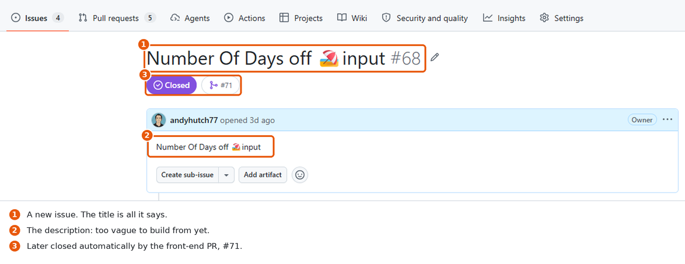

## 2. Triage asks questions

The [triage agent](../.github/workflows/triage.md) judged the issue too vague to plan.
It [asked three questions](https://github.com/andyhutch77/velocity-generator-rs/issues/68#issuecomment-6706779728)
and added the `blocked` label.

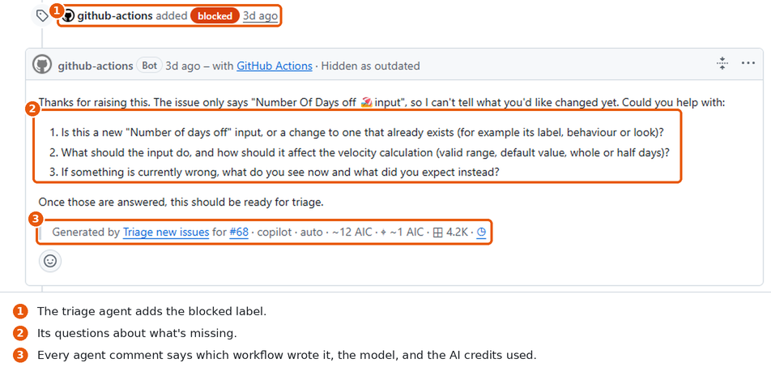

## 3. Answer, and triage looks again

The maintainer [answered on the issue](https://github.com/andyhutch77/velocity-generator-rs/issues/68#issuecomment-6706817371).
At the time, triage only ran when an issue was opened or reopened, so the issue was
closed and reopened to re-run it. Now a reply to a `blocked` issue re-runs triage
automatically. Triage [re-checked it](https://github.com/andyhutch77/velocity-generator-rs/issues/68#issuecomment-6706865563),
restated the request and marked it `needs-triage`, ready to plan.

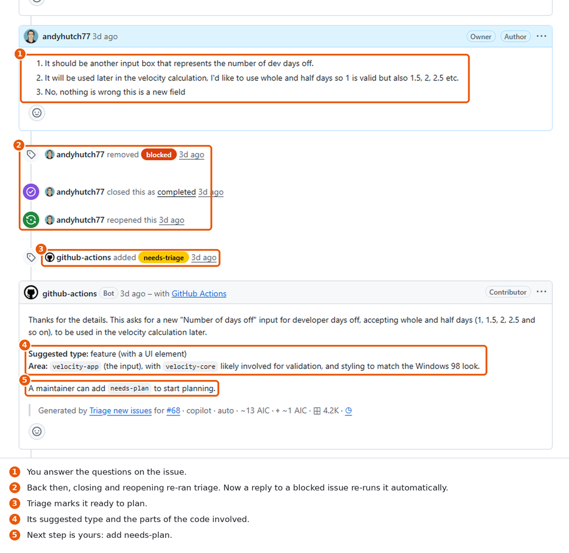

## 4. Ask for a plan

Adding the `needs-plan` label starts the [planner](../.github/workflows/plan.md). It
[posts a plan](https://github.com/andyhutch77/velocity-generator-rs/issues/68#issuecomment-6706946438)
with success criteria, tasks tagged `[rust]` or `[frontend]`, files, tests, risks and
what's out of scope, then labels the issue `plan-review`.

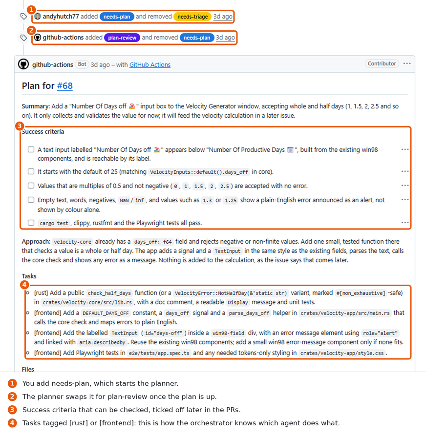

To change the plan, comment with feedback, then remove and re-add `needs-plan`. Each
new version hides the previous one.

## 5. The architect checks the plan

The planner also starts the [architect](../.github/workflows/arch-review.md), which
checks the plan against [ARCHITECTURE.md](../ARCHITECTURE.md) and posts a verdict before
you approve. (The architect was added after #68 was built, so this example is from
[issue #73](https://github.com/andyhutch77/velocity-generator-rs/issues/73#issuecomment-6776834602).)

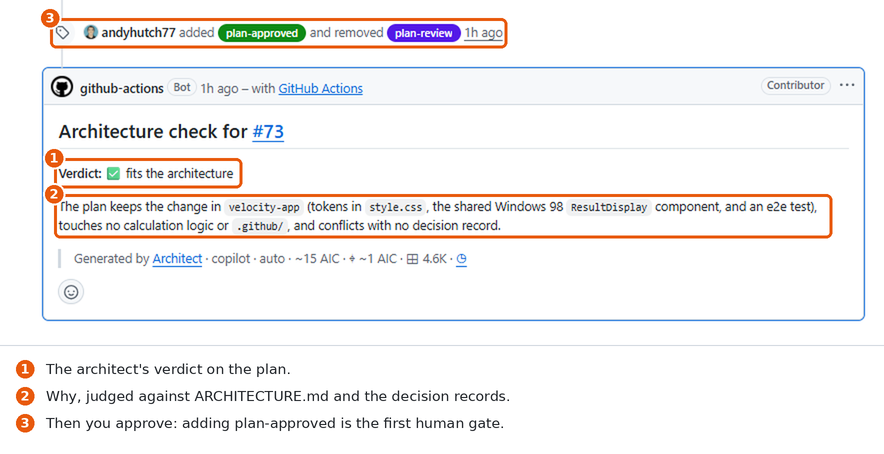

## 6. Approve the plan

Adding `plan-approved` is the first human gate. The
[orchestrator](../.github/workflows/orchestrate.md) reads the plan, sees `[rust]` tasks,
starts the Rust agent first, and
[posts a progress table](https://github.com/andyhutch77/velocity-generator-rs/issues/68#issuecomment-6707003702).

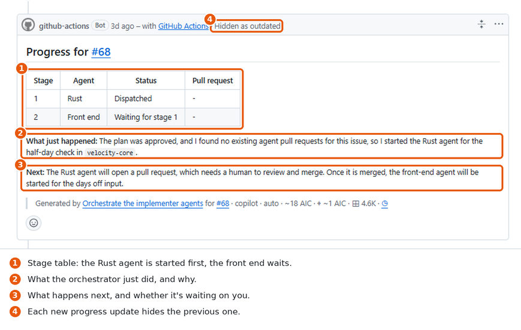

## 7. An agent opens a draft PR

The [Rust agent](../.github/workflows/impl-rust.md) did the `[rust]` tasks and opened
[draft PR #69](https://github.com/andyhutch77/velocity-generator-rs/pull/69). Agent PRs
are titled `[agent] …`, labelled `agent` and `rust` or `frontend`, and say `Part of #68`
so merging them doesn't close the issue while front-end work remains. The **Checks** tab
shows the CI run.

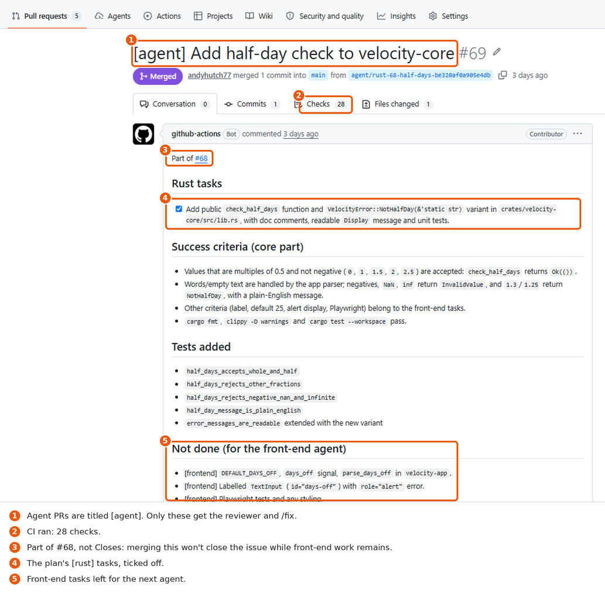

## 8. Mark it ready: CI and the reviewer run

Clicking **Ready for review** starts CI and the
[reviewer agent](../.github/workflows/pr-review.md). On the front-end
[PR #71](https://github.com/andyhutch77/velocity-generator-rs/pull/71), the reviewer
posted a summary against the plan, the architecture, the tests and accessibility, plus
line comments on the code.

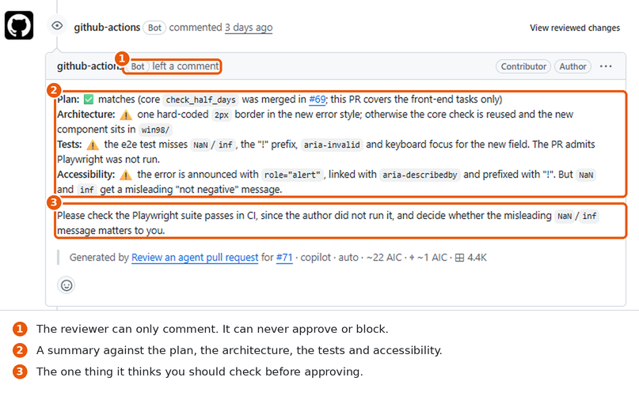

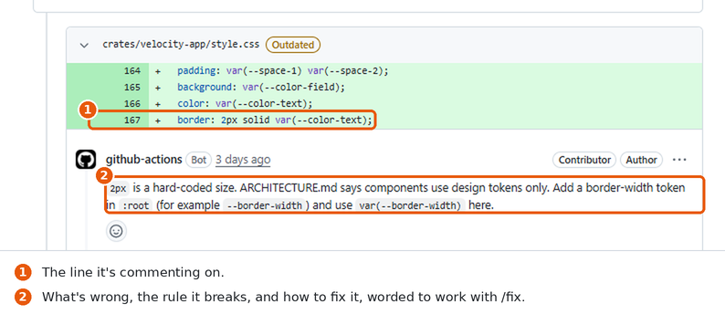

## 9. Ask for changes with /fix

Commenting [`/fix the comments`](https://github.com/andyhutch77/velocity-generator-rs/pull/71#issuecomment-6707785893)
started the [fix agent](../.github/workflows/pr-fix.md), which pushed a commit to the
same PR and [explained what it changed](https://github.com/andyhutch77/velocity-generator-rs/pull/71#issuecomment-6707845902).
After a fix, **Convert to draft** then **Ready for review** re-runs CI and the review.

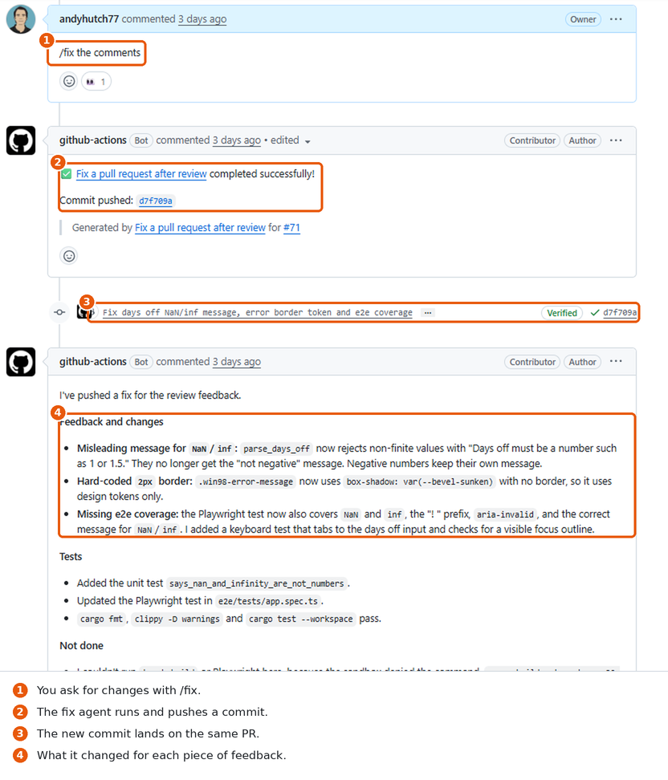

## 10. Approve and merge, and the next stage starts

Approving and merging is the second human gate. Merging the Rust PR re-ran the
orchestrator, which started the front-end agent for the `[frontend]` tasks. When that
PR merged too, it posted
[the final progress table](https://github.com/andyhutch77/velocity-generator-rs/issues/68#issuecomment-6707925276)
and the issue closed.

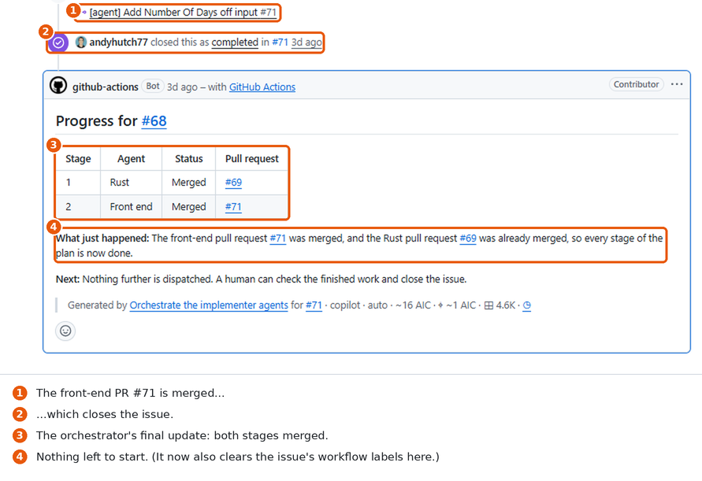

Since #68, the orchestrator also clears the issue's workflow labels at this point.

## 11. Approve the deploy

Every merge to `main` builds the app and records a signed build attestation. The deploy
then waits for the third human gate: click **Review deployments**, tick `github-pages`
and approve.

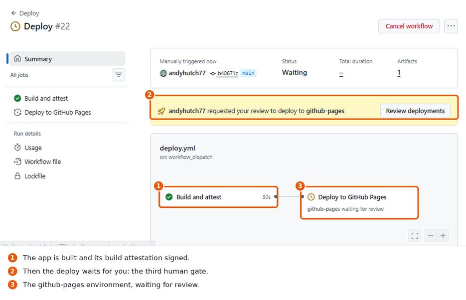

## 12. It's live

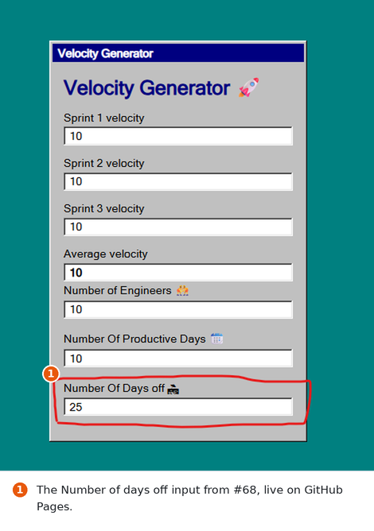

[andyhutch77.github.io/velocity-generator-rs](https://andyhutch77.github.io/velocity-generator-rs/)
